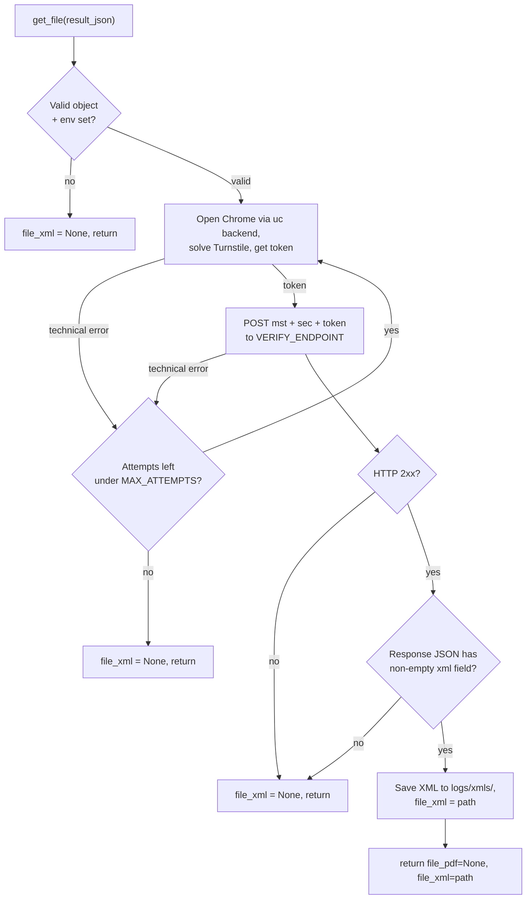

*English | [Tiếng Việt](INTEGRATION.vi.md)*

# Integration

The intended way to use this is as a drop-in for
`GetFolderTraCuuEinvoice365.get_file`: clone this repo as its own folder
inside the host project and call `get_file(result_json)` with one object.

## Layout after cloning

```
host-project/
├── app.py                      # host code
├── services/
│   └── invoice_service.py      # where you call get_file
└── turnstile-bypass-test/      # THIS repo, cloned as a folder
    ├── get_tracuu_einvoice365.py
    ├── EzSolver/
    ├── requirements.txt
    └── .env                    # created from .env.example
```

## Steps

**1. Clone into a subfolder**

```bash
cd host-project
git clone -b ezsolver-v2 https://github.com/Le-atuan/turnstile-bypass-test.git
```

Add `turnstile-bypass-test/` to the host project's `.gitignore`, or use a
git submodule, to avoid nesting a repo inside a repo.

**2. Install dependencies into the host project's Python environment**

```bash
pip install -r turnstile-bypass-test/requirements.txt
```

Use the same venv/interpreter the host app runs on. The machine needs real
Google Chrome (see [`README.md`](README.md#requirements)).

**3. Create `.env` inside the cloned folder**

```bash
cp turnstile-bypass-test/.env.example turnstile-bypass-test/.env
```

No edits needed if the target is unchanged. This `.env` is found even when
the host app runs from the parent directory — `python-dotenv` resolves it
relative to the module file, not the current working directory.

**4. Import and call**

The folder name `turnstile-bypass-test` contains hyphens, so it can't be
imported directly — add it to `sys.path` first:

```python
# services/invoice_service.py
import os, sys

VENDOR = os.path.join(os.path.dirname(__file__), "..", "turnstile-bypass-test")
sys.path.insert(0, os.path.abspath(VENDOR))

from get_tracuu_einvoice365 import get_file

def fetch_invoice(result_json):
    # result_json is the object your own API returns
    result = get_file(result_json)             # optional: get_file(result_json, download_dir="/your/dir")
    # -> {"file_pdf": None, "file_xml": "/abs/path/invoice_...xml" | None}
    return result
```

`EzSolver/` is added to the path automatically (relative to the module
file), so the working directory doesn't matter.

## How `get_file()` works



Unlike `run_test.py`: no `downloaded.json` skip check (always fetches),
no separate `not_found` branch (no XML just returns `None`), and the
retry wraps both the token-solve and the HTTP step.

## Contract

- **Input** — one `result_json` dict shaped `{"info": {"tax_code", "lookup_code"}}`
  (an object, not a list). A list is `run_test.py`'s job. If your API
  returns a different shape, adjust `extract_pair()`.
- **Output** — `{"file_pdf": None, "file_xml": <abs path | None>}`. `file_pdf`
  is always `None` (this path only retrieves XML).
- **Retries** — on a *technical* error only (token/HTTP failure), up to
  `MAX_ATTEMPTS`. A clean "no file" answer is final.
- **Config** — read from `.env` / environment: `TARGET_SITEURL`,
  `TARGET_SITEKEY`, `VERIFY_ENDPOINT`, `VERIFY_TOKEN_FIELD`,
  `SOLVER_BACKEND` (`uc` or `nodriver` — **recommended: `nodriver`**, `uc`
  has a known intermittent crash, see [`README.md`](README.md#backend)),
  `MAX_ATTEMPTS`, `DOWNLOAD_DIR`.

## Gotchas

- **Hyphenated folder name** → use `sys.path.insert(...)` then
  `import get_tracuu_einvoice365`; you cannot `import turnstile-bypass-test`.
- **Downloaded XML lives inside the cloned folder** (`turnstile-bypass-test/logs/xmls/`),
  since paths are relative to the module. Override with
  `get_file(obj, download_dir="/elsewhere")` or `DOWNLOAD_DIR` in `.env`.
- **Config is read at import time.** To set it via `os.environ` instead of
  `.env`, set the variables *before* importing the module. Using `.env`
  avoids this.
- **No import side effects** — the module adds no log handlers and opens no
  browser on import; a browser launches only when you call `get_file()`.
  Configure the `get_tracuu_einvoice365` logger if you want its logs.
