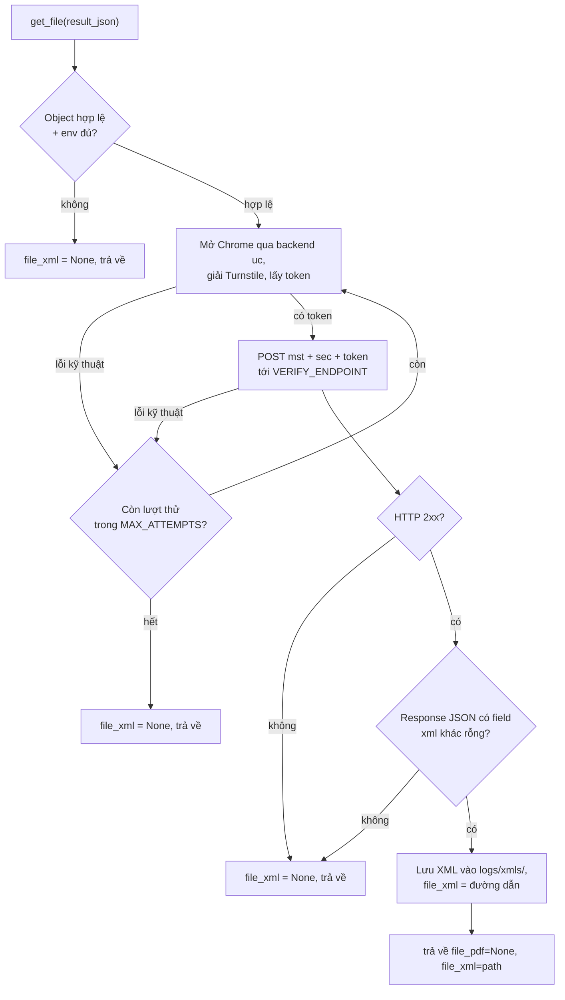

*[English](INTEGRATION.md) | Tiếng Việt*

# Tích hợp

Cách dùng đúng là thay thế `GetFolderTraCuuEinvoice365.get_file`: clone repo
này thành **một folder riêng** bên trong project chính, rồi gọi
`get_file(result_json)` với một object.

## Bố cục sau khi clone

```
project-cua-ban/
├── app.py                      # code của bạn
├── services/
│   └── invoice_service.py      # nơi gọi get_file
└── turnstile-bypass-test/      # REPO NÀY, clone thành 1 folder
    ├── get_tracuu_einvoice365.py
    ├── EzSolver/
    ├── requirements.txt
    └── .env                    # tạo từ .env.example
```

## Các bước

**1. Clone vào folder con**

```bash
cd project-cua-ban
git clone -b ezsolver-v2 https://github.com/Le-atuan/turnstile-bypass-test.git
```

Thêm `turnstile-bypass-test/` vào `.gitignore` của project cha, hoặc dùng
git submodule, để tránh lồng repo trong repo.

**2. Cài dependencies vào ĐÚNG môi trường Python của project**

```bash
pip install -r turnstile-bypass-test/requirements.txt
```

Cài vào cùng venv/interpreter mà app đang chạy. Máy phải có Google Chrome
thật (xem [`README.md`](README.md#backend) / mục Yêu cầu).

**3. Tạo `.env` bên trong folder đã clone**

```bash
cp turnstile-bypass-test/.env.example turnstile-bypass-test/.env
```

Không cần sửa gì nếu target không đổi. File `.env` này **vẫn được tìm thấy**
kể cả khi app chạy từ thư mục cha — `python-dotenv` dò theo vị trí file
module, không theo thư mục làm việc hiện tại.

**4. Import và gọi**

Tên folder `turnstile-bypass-test` có dấu gạch ngang nên không import thẳng
được — phải thêm vào `sys.path` trước:

```python
# services/invoice_service.py
import os, sys

VENDOR = os.path.join(os.path.dirname(__file__), "..", "turnstile-bypass-test")
sys.path.insert(0, os.path.abspath(VENDOR))

from get_tracuu_einvoice365 import get_file

def lay_hoa_don(result_json):
    # result_json là object API bên bạn trả về
    result = get_file(result_json)             # tùy chọn: get_file(result_json, download_dir="/thư/mục/của/bạn")
    # -> {"file_pdf": None, "file_xml": "/abs/path/invoice_...xml" | None}
    return result
```

`EzSolver/` được thêm vào path tự động (theo vị trí file module), nên thư
mục làm việc không quan trọng.

## `get_file()` hoạt động thế nào



Khác `run_test.py`: không kiểm `downloaded.json` (luôn lấy mới), không
phân nhánh `not_found` riêng (không có XML thì trả `None`), và retry bao
trọn cả bước giải token lẫn gửi HTTP.

## Hợp đồng (contract)

- **Vào** — một dict `result_json` dạng `{"info": {"tax_code", "lookup_code"}}`
  (một object, không phải mảng). Mảng là việc của `run_test.py`. Nếu API
  của bạn trả cấu trúc khác, chỉnh lại hàm `extract_pair()`.
- **Ra** — `{"file_pdf": None, "file_xml": <đường dẫn tuyệt đối | None>}`.
  `file_pdf` luôn `None` (luồng này chỉ lấy XML).
- **Retry** — chỉ khi **lỗi kỹ thuật** (lấy token/HTTP hỏng), tối đa
  `MAX_ATTEMPTS`. Câu trả lời "không có file" rõ ràng là kết quả cuối.
- **Cấu hình** — đọc từ `.env`/môi trường: `TARGET_SITEURL`,
  `TARGET_SITEKEY`, `VERIFY_ENDPOINT`, `VERIFY_TOKEN_FIELD`,
  `SOLVER_BACKEND` (`uc` hoặc `nodriver` — **khuyến nghị dùng `nodriver`**,
  `uc` có lỗi crash ngẫu nhiên đã biết, xem [`README.md`](README.md#backend)),
  `MAX_ATTEMPTS`, `DOWNLOAD_DIR`.

## Những điều dễ dính bẫy

- **Tên folder có dấu `-`** → dùng `sys.path.insert(...)` rồi
  `import get_tracuu_einvoice365`; không `import turnstile-bypass-test` được.
- **File XML tải xuống nằm trong folder đã clone**
  (`turnstile-bypass-test/logs/xmls/`) vì đường dẫn tính theo vị trí module.
  Đổi bằng `get_file(obj, download_dir="/chỗ/khác")` hoặc `DOWNLOAD_DIR` trong `.env`.
- **Cấu hình đọc lúc import.** Muốn set bằng `os.environ` thay vì `.env` thì
  phải set **trước khi** import module. Dùng `.env` thì không vướng.
- **Không side effect khi import** — module không thêm log handler và không
  mở browser lúc import; chỉ mở browser khi gọi `get_file()`. Cấu hình logger
  `get_tracuu_einvoice365` nếu muốn thấy log của nó.
