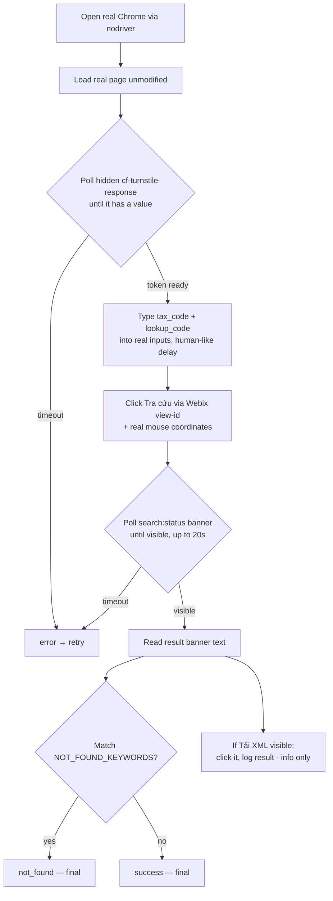

*English | [Tiếng Việt](README.vi.md)*

# ezsolver branch

Integrates [`ismoiloffS/EzSolver`](https://github.com/ismoiloffS/EzSolver)
(MIT) to test our own `tracuu.einvoice365.com` lookup page. See the
[`main` branch](../../tree/main) for the project overview. Install/run
steps: [`SETUP.md`](SETUP.md) / [`SETUP.vi.md`](SETUP.vi.md).

## Backends

Only `undetected-chromedriver` (`SOLVER_BACKEND=uc`, `EzSolver/solver_uc.py`)
actually gets past this site's Turnstile — it's the default for both
scripts below. `nodriver` and `playwright-stealth` were tried and
blocked; `run_ui_test.py` (nodriver-based) is kept only as the original
reference implementation, not for live testing.

## Tests

| Script | What it does | Answers |
|---|---|---|
| `run_test.py` | Gets a token via EzSolver (`uc`), then sends a raw HTTP POST straight to `POST /api/search` (endpoint/payload shape reverse-engineered with `capture_request.py`). Runs in the background, no visible browser needed for the HTTP step. Supports `MAX_WORKERS>1` to fire several test cases concurrently, each with its own browser. | "Does the backend accept a token with no real browser session behind it, and does it rate-limit concurrent requests?" |
| `run_ui_test_uc.py` | Loads the real page, fills the real form, clicks "Tra cứu", clicks "Tải XML" and verifies a real blob download. Logs the average step1→XML-download time across runs. | "Does the site detect a bot operating its actual UI, end-to-end to a real XML download?" |
| `run_ui_test.py` | Same UI flow as above but via `nodriver` — kept for reference; blocked by Turnstile on this site. | — |
| `capture_request.py` | One-off: drives the real UI with `uc`, hooks `fetch`/`XMLHttpRequest`, and dumps the exact request the page sends to `captured_request.json`. Used once to discover `run_test.py`'s endpoint/payload. | — |

All loop over the `TEST_CASES` pairs (tax_code / lookup_code) in `.env`.

## Commands

```bash
cp .env.example .env            # one-time setup: set TARGET_SITEURL/SITEKEY/TEST_CASES
pip install -r requirements.txt
```

### Primary test — background raw-HTTP bypass + XML download (preferred, no UI needed)

```bash
python run_test.py
```

Solves Turnstile, replays the token straight to `POST /api/search`, and
saves the real invoice XML to `logs/xmls/` for every test case — this is
the one to run by default.

### Same, but N test cases at once (to probe for missing rate-limiting)

```bash
MAX_WORKERS=4 python run_test.py
```

Runs up to 4 test cases concurrently, each with its own browser, to see
if the backend throttles/flags simultaneous identical requests.

### Full real-UI flow (fills the form, clicks the real buttons, confirms a real blob download)

```bash
python run_ui_test_uc.py
```

Drives the actual page end-to-end and logs the average step1→XML-download
time — use only when you specifically need to test the UI path itself.

### One-off: capture the exact request the live page sends

```bash
python capture_request.py
```

Already run once to reverse-engineer `run_test.py`'s endpoint/payload;
re-run only if the site's frontend changes.

## How `run_ui_test.py` works



Key point: EzSolver's own `solve_on_page()` runs
`document.body.innerHTML = ''` before solving — it **wipes the real
form**. So `run_ui_test.py` never calls it; it reuses only EzSolver's
browser-launch helpers and drives the real page itself.

## UI is built with Webix — why clicks use coordinates

- Only the two text inputs are real `<input>` elements → CSS placeholder
  selectors work.
- Buttons are Webix `<div>`s (not `<button>`), and DOM ids are
  randomized per reload. Each view has a **stable view-id**
  (`search:btnsearch`, `search:status`, `search:btnxml`) queryable via
  `webix.$$(...)`. We locate the real button that way, then click its
  on-screen coordinates with a real mouse move — recon found the sibling
  "Tải XML" button has **no click handler bound**, so synthetic
  `.click()` is unreliable.
- The result banner (`search:status`) can take **5-8s** to appear — we
  poll it, not a fixed sleep.
- `run_ui_test.py` also clicks "Tải XML" when visible and logs whether a
  new tab / file blob resulted — informational only, never affects the
  outcome. (Its missing handler looks like a possible site bug, worth
  flagging separately.)

## Outcomes & retries

Only a **technical error** retries (up to `MAX_ATTEMPTS`). A real answer
from the site is always final. **`success` only counts when the XML was
actually downloaded (confirmed via a new blob) or the site reported "not
found"** — anything else (e.g. the "Tải XML" button appears but no blob
is created) is treated as `error`, not success.

| Outcome | Meaning | Retried? |
|---|---|---|
| `success` | XML confirmed downloaded (`run_ui_test_uc.py`) / banner shown with no "not found" phrase (`run_test.py`) | No |
| `not_found` | Banner/response matched `NOT_FOUND_KEYWORDS` (valid "no record") | No |
| `error` | A step crashed/timed out, incl. "Tải XML" present but download unconfirmed | **Yes** |

`run_test.py` adds a 4th, `rejected` (backend returned non-2xx), also
final — that's the "does the backend have a second layer" signal.

`run_ui_test_uc.py`'s SUMMARY line also reports the **average step1 →
XML-download time**, computed only over runs with a confirmed download.

## Running several in parallel

`run_test.py` with `MAX_WORKERS>1` in `.env` runs that many test cases
concurrently, each in its own browser instance — used to check whether
the backend rate-limits/flags concurrent identical requests from one
machine (as of this testing, it does not).

`NOT_FOUND_KEYWORDS` is a **guessed, unconfirmed** list — adjust it once
a real "not found" response is observed.

## Logging

Each run writes `logs/<script>_<timestamp>.log` (full detail +
tracebacks) alongside concise console output. On a step failure it also
saves a screenshot + page HTML to `logs/`. XML files downloaded via
`run_test.py` land in `logs/xmls/`. **`logs/` is gitignored** — it can
contain real invoice data.

### Cleanup scripts

```bash
./clear_logs.sh       # delete all *.log files in logs/
./clear_images.sh     # delete all failure screenshots/HTML (*.png, *.html) in logs/
./clear_xmls.sh       # delete all downloaded XML files in logs/xmls/
./clear_run_test.sh   # delete all run_test.py logs (logs/run_test_*.log)
./clear_ui_test.sh    # delete all run_ui_test.py / run_ui_test_uc.py logs (logs/ui_test_*.log)
```

## Requirements

Real Google Chrome (not just Chromium — `nodriver` drives it over the
DevTools Protocol); Xvfb on headless Linux; `CHROME_PATH` if Chrome isn't
auto-detected. **Not yet run end-to-end here** (this sandbox has no real
Chrome / no network to the target) — verify nodriver method names against
your installed version on first local run.
