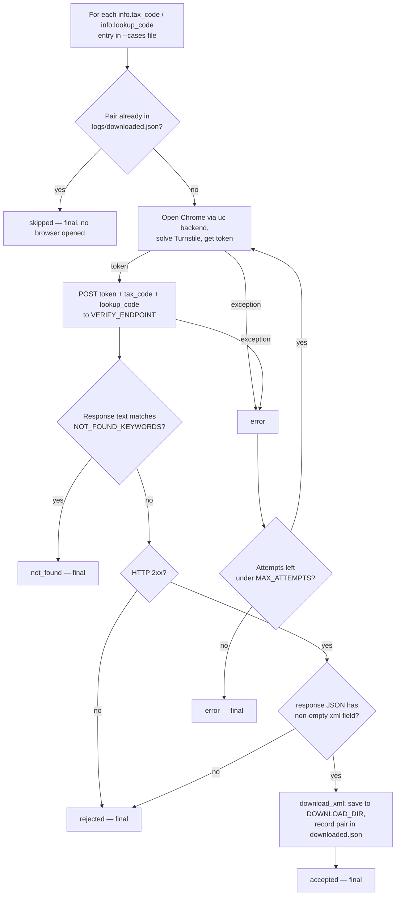
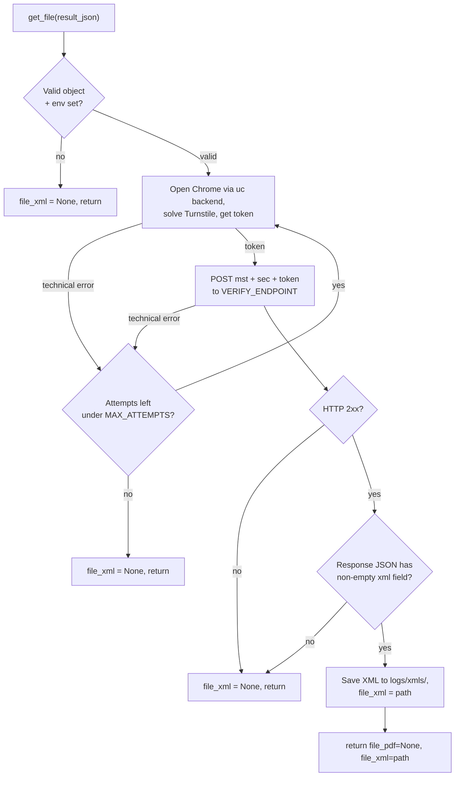

*English | [Tiếng Việt](README.vi.md)*

# ezsolver branch

Integrates [`ismoiloffS/EzSolver`](https://github.com/ismoiloffS/EzSolver)
(MIT) to test our own `tracuu.einvoice365.com` lookup page. See the
[`main` branch](../../tree/main) for the project overview. Install/run
steps: [`SETUP.md`](SETUP.md) / [`SETUP.vi.md`](SETUP.vi.md).

## Backend

Only `undetected-chromedriver` (`SOLVER_BACKEND=uc`, `EzSolver/solver_uc.py`)
actually gets past this site's Turnstile — it's the default and only
backend used here. `nodriver` and `playwright-stealth` were tried and
blocked.

## Scripts

| Script | Input | What it does |
|---|---|---|
| `get_tracuu_einvoice365.py` | **one** result_json object | Fetches a single invoice and returns `{"file_pdf": None, "file_xml": <path>}`. The integration entry point — import `get_file()` into your own project, or run it standalone for one file. |
| `run_test.py` | a **list** of objects | Test harness: solves Turnstile via the `uc` backend, replays the token to `POST /api/search` (endpoint/payload reverse-engineered with `capture_request.py`) for every case, saves each XML. Supports `MAX_WORKERS>1` to fire cases concurrently, each with its own browser — answers "does the backend accept a token with no real browser session, and does it rate-limit?" |
| `capture_request.py` | — | One-off: drives the real UI with `uc`, hooks `fetch`/`XMLHttpRequest`, and dumps the exact request the page sends to `captured_request.json`. Used once to discover the endpoint/payload. |

`run_test.py` loops over the pairs in `test_cases.json` (or `--cases <path>`);
`get_tracuu_einvoice365.py` handles exactly one.

## Commands

```bash
cp .env.example .env            # one-time setup: set TARGET_SITEURL/SITEKEY
pip install -r requirements.txt
```

### Fetch ONE invoice (single object in → one file out)

```bash
python get_tracuu_einvoice365.py --case '{"info": {"tax_code": "0314218920", "lookup_code": "j5nnm3lzo5"}}'
```

Or from a file holding one object, or piped via stdin:

```bash
python get_tracuu_einvoice365.py --file one_case.json
echo '{"info": {"tax_code": "...", "lookup_code": "..."}}' | python get_tracuu_einvoice365.py
```

Prints the result dict and saves the XML to `logs/xmls/` (override with
`--out <dir>`). This is the script to run for a single lookup, and the
module to import when integrating into your own project (see below).

### Primary test — background raw-HTTP bypass + XML download (preferred, no UI needed)

```bash
python run_test.py
```

Solves Turnstile, replays the token straight to `POST /api/search`, and
saves the real invoice XML to `logs/xmls/` (or `DOWNLOAD_DIR` if set in
`.env`) for every test case — this is the one to run by default. Runs
unattended, with no authorization prompt. Test cases come from
`test_cases.json` if that file exists, else from `TEST_CASES` in `.env`
— either way a JSON list of result_json-shaped
`{"info": {"tax_code": "...", "lookup_code": "..."}}` objects; pairs
already in `logs/downloaded.json` are skipped. Use a different file (e.g.
a batch of 1000) with:

```bash
python run_test.py --cases /path/to/your_file.json
```

(replace `/path/to/your_file.json` with the real path to your own file)

### Same, but N test cases at once (to probe for missing rate-limiting)

```bash
MAX_WORKERS=4 python run_test.py
```

Runs up to 4 test cases concurrently, each with its own browser, to see
if the backend throttles/flags simultaneous identical requests.

### One-off: capture the exact request the live page sends

```bash
python capture_request.py
```

Already run once to reverse-engineer `run_test.py`'s endpoint/payload;
re-run only if the site's frontend changes.

## How `run_test.py` works



For a single invoice, use `get_tracuu_einvoice365.py` instead — same
solve+verify+save, one object in, one file out (see **Integration**).

Jobs for different test cases run concurrently when `MAX_WORKERS>1` (each
its own browser, via `ThreadPoolExecutor`); only `error` retries — `skipped`,
`not_found`, `rejected` and `accepted` are always final.

## Outcomes & retries

Only a **technical error** retries (up to `MAX_ATTEMPTS`). A real answer
from the site is always final.

| Outcome | Meaning | Retried? |
|---|---|---|
| `accepted` | HTTP 2xx and the XML was actually saved | No |
| `rejected` | Backend returned non-2xx | No |
| `not_found` | Response matched `NOT_FOUND_KEYWORDS` (valid "no record") | No |
| `error` | Token acquisition or the HTTP request itself failed | **Yes** |
| `skipped` | XML already downloaded in a previous run | No |

## Running several in parallel

`run_test.py` with `MAX_WORKERS>1` in `.env` runs that many test cases
concurrently, each in its own browser instance — used to check whether
the backend rate-limits/flags concurrent identical requests from one
machine (as of this testing, it does not).

`NOT_FOUND_KEYWORDS` is a **guessed, unconfirmed** list — adjust it once
a real "not found" response is observed.

## Logging

Each run writes `logs/<script>_<timestamp>.log` (full detail +
tracebacks) alongside concise console output. On a step failure it also
saves a screenshot + page HTML to `logs/`. XML files downloaded via
`run_test.py` land in `logs/xmls/` (or `DOWNLOAD_DIR` if set). **`logs/`
is gitignored** — it can contain real invoice data.

## Integration

The intended way to use this is as a drop-in for
`GetFolderTraCuuEinvoice365.get_file`: clone this repo as its own folder
inside the host project and call `get_file(result_json)` with one object.

### Layout after cloning

```
host-project/
├── app.py                      # host code
├── services/
│   └── invoice_service.py      # where you call get_file
└── turnstile-bypass-test/      # THIS repo, cloned as a folder
    ├── get_tracuu_einvoice365.py
    ├── EzSolver/
    ├── requirements.txt
    └── .env                    # created from .env.example
```

### Steps

**1. Clone into a subfolder**

```bash
cd host-project
git clone -b ezsolver-v2 https://github.com/Le-atuan/turnstile-bypass-test.git
```

Add `turnstile-bypass-test/` to the host project's `.gitignore`, or use a
git submodule, to avoid nesting a repo inside a repo.

**2. Install dependencies into the host project's Python environment**

```bash
pip install -r turnstile-bypass-test/requirements.txt
```

Use the same venv/interpreter the host app runs on. The machine needs real
Google Chrome (see Requirements).

**3. Create `.env` inside the cloned folder**

```bash
cp turnstile-bypass-test/.env.example turnstile-bypass-test/.env
```

No edits needed if the target is unchanged. This `.env` is found even when
the host app runs from the parent directory — `python-dotenv` resolves it
relative to the module file, not the current working directory.

**4. Import and call**

The folder name `turnstile-bypass-test` contains hyphens, so it can't be
imported directly — add it to `sys.path` first:

```python
# services/invoice_service.py
import os, sys

VENDOR = os.path.join(os.path.dirname(__file__), "..", "turnstile-bypass-test")
sys.path.insert(0, os.path.abspath(VENDOR))

from get_tracuu_einvoice365 import get_file

def fetch_invoice(result_json):
    # result_json is the object your own API returns
    result = get_file(result_json)             # optional: get_file(result_json, download_dir="/your/dir")
    # -> {"file_pdf": None, "file_xml": "/abs/path/invoice_...xml" | None}
    return result
```

`EzSolver/` is added to the path automatically (relative to the module
file), so the working directory doesn't matter.

### How `get_file()` works



Unlike `run_test.py`: no `downloaded.json` skip check (always fetches),
no separate `not_found` branch (no XML just returns `None`), and the
retry wraps both the token-solve and the HTTP step.

### Contract

- **Input** — one `result_json` dict shaped `{"info": {"tax_code", "lookup_code"}}`
  (an object, not a list). A list is `run_test.py`'s job. If your API
  returns a different shape, adjust `extract_pair()`.
- **Output** — `{"file_pdf": None, "file_xml": <abs path | None>}`. `file_pdf`
  is always `None` (this path only retrieves XML).
- **Retries** — on a *technical* error only (token/HTTP failure), up to
  `MAX_ATTEMPTS`. A clean "no file" answer is final.
- **Config** — read from `.env` / environment: `TARGET_SITEURL`,
  `TARGET_SITEKEY`, `VERIFY_ENDPOINT`, `VERIFY_TOKEN_FIELD`,
  `SOLVER_BACKEND` (`uc`), `MAX_ATTEMPTS`, `DOWNLOAD_DIR`.

### Gotchas

- **Hyphenated folder name** → use `sys.path.insert(...)` then
  `import get_tracuu_einvoice365`; you cannot `import turnstile-bypass-test`.
- **Downloaded XML lives inside the cloned folder** (`turnstile-bypass-test/logs/xmls/`),
  since paths are relative to the module. Override with
  `get_file(obj, download_dir="/elsewhere")` or `DOWNLOAD_DIR` in `.env`.
- **Config is read at import time.** To set it via `os.environ` instead of
  `.env`, set the variables *before* importing the module. Using `.env`
  avoids this.
- **No import side effects** — the module adds no log handlers and opens no
  browser on import; a browser launches only when you call `get_file()`.
  Configure the `get_tracuu_einvoice365` logger if you want its logs.

## Requirements

Real Google Chrome (not just Chromium — `undetected-chromedriver` drives
it); Xvfb on headless Linux; `CHROME_PATH` if Chrome isn't auto-detected.
