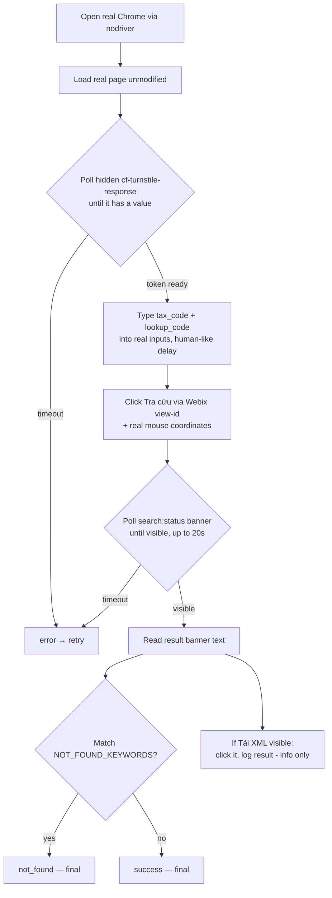

*English | [Tiếng Việt](README.vi.md)*

# ezsolver branch

Integrates [`ismoiloffS/EzSolver`](https://github.com/ismoiloffS/EzSolver)
(MIT) to test our own `tracuu.einvoice365.com` lookup page. See the
[`main` branch](../../tree/main) for the project overview. Install/run
steps: [`SETUP.md`](SETUP.md) / [`SETUP.vi.md`](SETUP.vi.md).

## Two tests

| Script | What it does | Answers |
|---|---|---|
| `run_test.py` | Gets a token via EzSolver, then sends a raw HTTP POST to the backend endpoint. | "Does the backend accept a token with no real browser session behind it?" |
| `run_ui_test.py` | Loads the real page, fills the real form, clicks the real "Tra cứu" button, reads the result. | "Does the site detect a bot operating its actual UI?" |

Both loop over the 4 real, owner-authorized `TEST_CASES` pairs
(tax_code / lookup_code) in `.env.example`.

## How `run_ui_test.py` works

Key point: EzSolver's own `solve_on_page()` runs
`document.body.innerHTML = ''` before solving — it **wipes the real
form**. So `run_ui_test.py` never calls it; it reuses only EzSolver's
browser-launch helpers and drives the real page itself.

## UI is built with Webix — why clicks use coordinates

- Only the two text inputs are real `<input>` elements → CSS placeholder
  selectors work.
- Buttons are Webix `
`s (not `<button>`), and DOM ids are
  randomized per reload. Each view has a **stable view-id**
  (`search:btnsearch`, `search:status`, `search:btnxml`) queryable via
  `webix.$$(...)`. We locate the real button that way, then click its
  on-screen coordinates with a real mouse move — recon found the sibling
  "Tải XML" button has **no click handler bound**, so synthetic
  `.click()` is unreliable.
- The result banner (`search:status`) can take **5-8s** to appear — we
  poll it, not a fixed sleep.
- `run_ui_test.py` also clicks "Tải XML" when visible and logs whether a
  new tab / file blob resulted — informational only, never affects the
  outcome. (Its missing handler looks like a possible site bug, worth
  flagging separately.)

## Outcomes & retries

Only a **technical error** retries (up to `MAX_ATTEMPTS`, default 3) —
a real answer from the site is always final.

| Outcome | Meaning | Retried? |
|---|---|---|
| `success` | Result banner shown, no "not found" phrase | No |
| `not_found` | Banner matched `NOT_FOUND_KEYWORDS` (valid "no record") | No |
| `error` | A step crashed/timed out (incl. no banner within timeout) | **Yes** |

`run_test.py` adds a 4th, `rejected` (backend returned non-2xx), also
final — that's the "does the backend have a second layer" signal.

`NOT_FOUND_KEYWORDS` is a **guessed, unconfirmed** list — adjust it once
a real "not found" response is observed.

## Logging

Each run writes `logs/<script>_<timestamp>.log` (full detail +
tracebacks) alongside concise console output. On a step failure it also
saves a screenshot + page HTML to `logs/`. **`logs/` is gitignored** — it
can contain real invoice data.

## Requirements

Real Google Chrome (not just Chromium — `nodriver` drives it over the
DevTools Protocol); Xvfb on headless Linux; `CHROME_PATH` if Chrome isn't
auto-detected. **Not yet run end-to-end here** (this sandbox has no real
Chrome / no network to the target) — verify nodriver method names against
your installed version on first local run.
