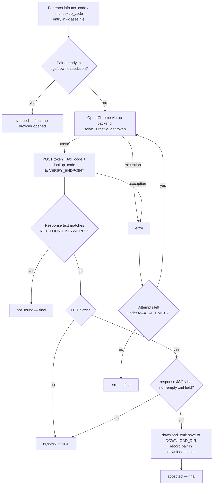

*English | [Tiếng Việt](README.vi.md)*

# ezsolver branch

Integrates [`ismoiloffS/EzSolver`](https://github.com/ismoiloffS/EzSolver)
(MIT) to test our own `tracuu.einvoice365.com` lookup page. See the
[`main` branch](../../tree/main) for the project overview. Install/run
steps: [`SETUP.md`](SETUP.md) / [`SETUP.vi.md`](SETUP.vi.md). Integrating
this into your own project: [`INTEGRATION.md`](INTEGRATION.md) /
[`INTEGRATION.vi.md`](INTEGRATION.vi.md).

## Backend

Both `undetected-chromedriver` (`SOLVER_BACKEND=uc`, `EzSolver/solver_uc.py`)
and `nodriver` (`SOLVER_BACKEND=nodriver`, `EzSolver/solver.py`) get past
this site's Turnstile. The site ships a CSP (`script-src` with a `nonce` +
`strict-dynamic`) that blocks a self-injected Turnstile widget — both
solvers instead read the token straight off the page's own native
`.cf-turnstile` widget, which auto-verifies in the background a few
seconds after page load, no click needed. `playwright-stealth` was tried
and blocked.

**Recommended backend: `nodriver`.** `uc` has an intermittent
`NoSuchWindowException` crash (~browser dies mid-run) seen with recent
Chrome builds (observed on 156.0.8078.80) — it's a driver/Chrome-version
flakiness issue, unrelated to the site's defenses, and not fully fixed by
clearing the `undetected_chromedriver` cache. `nodriver` has been stable
across all testing so far.

## Scripts

| Script | Input | What it does |
|---|---|---|
| `get_tracuu_einvoice365.py` | **one** result_json object | Fetches a single invoice and returns `{"file_pdf": None, "file_xml": <path>}`. The integration entry point — import `get_file()` into your own project, or run it standalone for one file. |
| `run_test.py` | a **list** of objects | Test harness: solves Turnstile via the `uc` backend, replays the token to `POST /api/search` (endpoint/payload reverse-engineered with `capture_request.py`) for every case, saves each XML. Supports `MAX_WORKERS>1` to fire cases concurrently, each with its own browser — answers "does the backend accept a token with no real browser session, and does it rate-limit?" |
| `run_ui_test.py` | a **list** of objects (`TEST_CASES` in `.env`) | UI bot-detection test via `nodriver` (`EzSolver/solver.py`): drives the real page — waits for Turnstile, fills the real form, clicks "Tra cứu", reads the result — instead of replaying the token over raw HTTP. Checks whether the site detects a bot operating its UI (not just a bot calling its API). Runs unattended, no confirmation prompt. |
| `capture_request.py` | — | One-off: drives the real UI with `uc`, hooks `fetch`/`XMLHttpRequest`, and dumps the exact request the page sends to `captured_request.json`. Used once to discover the endpoint/payload. |

`run_test.py` loops over the pairs in `test_cases.json` (or `--cases <path>`);
`get_tracuu_einvoice365.py` handles exactly one. `run_ui_test.py` loops over
`TEST_CASES` in `.env` — same `{"info": {"tax_code": "...", "lookup_code": "..."}}`
shape, each entry unwrapped before use.

## Commands

```bash
cp .env.example .env            # one-time setup: set TARGET_SITEURL/SITEKEY
pip install -r requirements.txt
```

### Fetch ONE invoice (single object in → one file out)

```bash
python get_tracuu_einvoice365.py --case '{"info": {"tax_code": "0314218920", "lookup_code": "j5nnm3lzo5"}}'
```

Or from a file holding one object, or piped via stdin:

```bash
python get_tracuu_einvoice365.py --file one_case.json
echo '{"info": {"tax_code": "...", "lookup_code": "..."}}' | python get_tracuu_einvoice365.py
```

Prints the result dict and saves the XML to `logs/xmls/` (override with
`--out <dir>`). This is the script to run for a single lookup, and the
module to import when integrating into your own project (see below).

### Primary test — background raw-HTTP bypass + XML download (preferred, no UI needed)

```bash
python run_test.py
```

Solves Turnstile, replays the token straight to `POST /api/search`, and
saves the real invoice XML to `logs/xmls/` (or `DOWNLOAD_DIR` if set in
`.env`) for every test case — this is the one to run by default. Runs
unattended, with no authorization prompt. Test cases come from
`test_cases.json` if that file exists, else from `TEST_CASES` in `.env`
— either way a JSON list of result_json-shaped
`{"info": {"tax_code": "...", "lookup_code": "..."}}` objects; pairs
already in `logs/downloaded.json` are skipped. Use a different file (e.g.
a batch of 1000) with:

```bash
python run_test.py --cases /path/to/your_file.json
```

(replace `/path/to/your_file.json` with the real path to your own file)

### Same, but N test cases at once (to probe for missing rate-limiting)

```bash
MAX_WORKERS=4 python run_test.py
```

Runs up to 4 test cases concurrently, each with its own browser, to check
whether the backend rate-limits/flags concurrent identical requests from
one machine (as of this testing, it does not).

### UI bot-detection test (drives the real page, not raw HTTP)

```bash
python run_ui_test.py       # nodriver backend — recommended, stable
```

Fills the real MST/lookup-code fields and clicks the real "Tra cứu"
button like a user would, instead of replaying the token over raw HTTP —
checks whether the site flags bot-driven UI interaction. Test cases come
from `TEST_CASES` in `.env` only (same `{"info": {"tax_code", "lookup_code"}}`
shape as `run_test.py`). Runs unattended, no confirmation prompt.

### One-off: capture the exact request the live page sends

```bash
python capture_request.py
```

Already run once to reverse-engineer `run_test.py`'s endpoint/payload;
re-run only if the site's frontend changes.

## How `run_test.py` works



For a single invoice, use `get_tracuu_einvoice365.py` instead (see
[`INTEGRATION.md`](INTEGRATION.md)).

## Outcomes & retries

The response is classified by **real HTTP signals** (status, `Retry-After`,
Cloudflare markers, JSON shape) — block/limit is checked **before** the
not-found phrase, so a challenge page can't be mislabeled as "not found".
Only transient technical errors retry (up to `MAX_ATTEMPTS`); a real answer
is always final.

| Outcome | Meaning | Retried? |
|---|---|---|
| `accepted` | HTTP 2xx and the XML was present/saved | No |
| `not_found` | 2xx, no xml, a genuine "no record" message (`NOT_FOUND_KEYWORDS`) | No |
| `rate_limited` | HTTP 429 or a `Retry-After` header — throttled | No |
| `blocked` | Bot challenge / WAF block (`cf-mitigated`, a `CHALLENGE_MARKERS` phrase, or HTML on 403/503) | No |
| `server_error` | HTTP 5xx — transient | **Yes** |
| `rejected` | Other non-2xx, or 2xx with no xml and no clear reason | No |
| `error` | Token acquisition or the HTTP call itself failed | **Yes** |
| `skipped` | XML already downloaded in a previous run | No |

`rate_limited` and `blocked` are the second-layer-defense signals: when a
valid invoice (one a manual lookup still finds) comes back as one of these
after a burst of automated requests, that's the site throttling the bot.
Full status + headers + body snippet for every non-accepted run are in the
`logs/` file at DEBUG level, to confirm which category it really is.
Tune detection via `RATE_LIMIT_STATUSES` and `CHALLENGE_MARKERS` in `.env`.
`NOT_FOUND_KEYWORDS` is a **guessed, unconfirmed** list — adjust it once a
real "not found" response is observed.

## Logging

Each run writes `logs/<script>_<timestamp>.log` (full detail +
tracebacks) alongside concise console output. XML files downloaded via
`run_test.py` land in `logs/xmls/` (or `DOWNLOAD_DIR` if set). **`logs/`
is gitignored** — it can contain real invoice data.

On a failure the log says **why**, not just what: each exception is tagged
with a category — `MACHINE_SLEPT`, `BROWSER_DEAD` (crash/OOM/sleep),
`BROWSER_FROZEN` (unresponsive — challenge/sleep/overload), `PAGE_TIMEOUT`,
`TURNSTILE`, `NETWORK`, `CHROME_MISSING`, `UNKNOWN` — plus the root-cause
chain and context (elapsed, backend, workers, free memory). A background
**sleep watchdog** detects a system suspend/long freeze (wall-vs-monotonic
clock drift); it does not stop the run, it just tags errors that follow as
`MACHINE_SLEPT` so a laptop that slept is never mistaken for the site
blocking you.

## Integration

See [`INTEGRATION.md`](INTEGRATION.md) / [`INTEGRATION.vi.md`](INTEGRATION.vi.md)
for using this as a drop-in for `GetFolderTraCuuEinvoice365.get_file` in
your own project (layout, import, contract, gotchas).

## Requirements

Real Google Chrome (not just Chromium — `undetected-chromedriver` drives
it); Xvfb on headless Linux; `CHROME_PATH` if Chrome isn't auto-detected.
