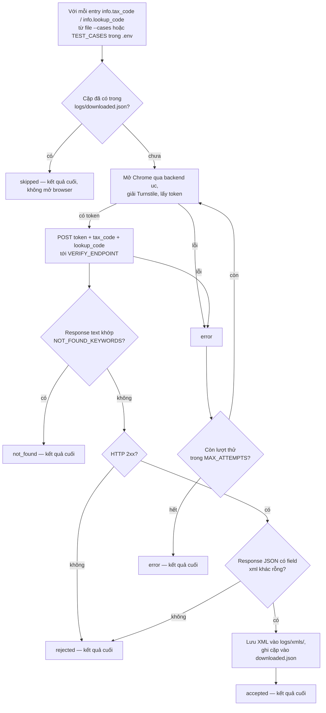

*[English](README.md) | Tiếng Việt*

# Nhánh ezsolver

Tích hợp [`ismoiloffS/EzSolver`](https://github.com/ismoiloffS/EzSolver)
(MIT) để test trang tra cứu `tracuu.einvoice365.com` của chúng ta. Xem
[nhánh `main`](../../tree/main) để có tổng quan. Hướng dẫn cài/chạy:
[`SETUP.md`](SETUP.md) / [`SETUP.vi.md`](SETUP.vi.md). Hướng dẫn tích hợp
vào project của bạn: [`INTEGRATION.md`](INTEGRATION.md) /
[`INTEGRATION.vi.md`](INTEGRATION.vi.md).

## Backend giải Turnstile

Cả `undetected-chromedriver` (`SOLVER_BACKEND=uc`, `EzSolver/solver_uc.py`)
và `nodriver` (`SOLVER_BACKEND=nodriver`, `EzSolver/solver.py`) đều vượt
được Turnstile của site này. Site có CSP (`script-src` kèm `nonce` +
`strict-dynamic`) chặn widget Turnstile tự inject — cả 2 solver đọc token
trực tiếp từ widget `.cf-turnstile` có sẵn trên trang, tự auto-verify sau
vài giây, không cần click. `playwright-stealth` đã thử và bị chặn.

**Backend khuyến nghị: `nodriver`.** `uc` có lỗi crash ngẫu nhiên
`NoSuchWindowException` (browser chết giữa lúc chạy) với các bản Chrome
gần đây (gặp trên 156.0.8078.80) — đây là vấn đề tương thích
driver/Chrome, không liên quan đến phòng thủ của site, và xóa cache
`undetected_chromedriver` cũng không hết hẳn. `nodriver` chạy ổn định
xuyên suốt các lần test.

## Các script

| Script | Nhận vào | Làm gì |
|---|---|---|
| `get_tracuu_einvoice365.py` | **một** object result_json | Lấy **một** hóa đơn, trả về `{"file_pdf": None, "file_xml": <đường dẫn>}`. Đây là điểm vào để tích hợp — import `get_file()` vào project của bạn, hoặc chạy trực tiếp để lấy 1 file. |
| `run_test.py` | một **mảng** object | Harness test: giải Turnstile qua backend `uc`, gửi token tới `POST /api/search` (endpoint/payload reverse-engineer bằng `capture_request.py`) cho từng bộ, lưu từng XML. Hỗ trợ `MAX_WORKERS>1` để chạy song song, mỗi bộ 1 browser — trả lời: "Backend có nhận token mà không cần phiên trình duyệt thật, và có rate-limit không?" |
| `run_ui_test.py` | một **mảng** object (`TEST_CASES` trong `.env`) | Test bot-detection trên UI qua `nodriver` (`EzSolver/solver.py`): lái trang thật — chờ Turnstile, điền form thật, click "Tra cứu", đọc kết quả — thay vì replay token qua raw HTTP. Kiểm tra site có phát hiện bot điều khiển UI không (không chỉ API). Chạy không cần xác nhận. |
| `capture_request.py` | — | Chạy 1 lần: lái UI thật bằng `uc`, hook `fetch`/`XMLHttpRequest`, dump đúng request trang gửi vào `captured_request.json`. Dùng để tìm ra endpoint/payload. |

`run_test.py` lặp qua các cặp trong `test_cases.json` (hoặc `--cases <path>`);
`get_tracuu_einvoice365.py` xử lý đúng một cặp. `run_ui_test.py` lặp qua
`TEST_CASES` trong `.env` — cùng shape
`{"info": {"tax_code": "...", "lookup_code": "..."}}`.

## Các lệnh chạy

```bash
cp .env.example .env            # cài 1 lần: set TARGET_SITEURL/SITEKEY
pip install -r requirements.txt
```

### Lấy MỘT hóa đơn (vào là 1 object → ra 1 file)

```bash
python get_tracuu_einvoice365.py --case '{"info": {"tax_code": "0314218920", "lookup_code": "j5nnm3lzo5"}}'
```

Hoặc đọc từ file chứa 1 object, hoặc pipe qua stdin:

```bash
python get_tracuu_einvoice365.py --file one_case.json
echo '{"info": {"tax_code": "...", "lookup_code": "..."}}' | python get_tracuu_einvoice365.py
```

In ra dict kết quả và lưu XML vào `logs/xmls/` (đổi bằng `--out <dir>`).
Đây là script để chạy khi chỉ tra 1 hồ sơ, và là module để import khi
tích hợp vào project của bạn (xem bên dưới).

### Bài test chính — bypass qua raw-HTTP chạy ngầm + tải XML (ưu tiên, không cần UI)

```bash
python run_test.py
```

Giải Turnstile, gửi thẳng token tới `POST /api/search`, và lưu file XML
hóa đơn thật vào `logs/xmls/` cho mỗi bộ test — đây là lệnh nên chạy mặc
định, không hỏi xác nhận. Bộ test lấy từ `test_cases.json` nếu file đó
tồn tại, không thì lấy từ `TEST_CASES` trong `.env` — dù nguồn nào cũng
phải là 1 mảng JSON các object dạng `{"info": {"tax_code": "...",
"lookup_code": "..."}}`; cặp nào đã có trong `logs/downloaded.json` sẽ bị
skip. Dùng file khác (ví dụ batch 1000 bộ) bằng:

```bash
python run_test.py --cases /đường/dẫn/tới/file_của_bạn.json
```

(thay `/đường/dẫn/tới/file_của_bạn.json` bằng đường dẫn thật tới file của bạn)

### Tương tự nhưng chạy N bộ cùng lúc (để dò xem có bị rate-limit không)

```bash
MAX_WORKERS=4 python run_test.py
```

Chạy đồng thời tối đa 4 bộ hồ sơ, mỗi bộ 1 browser riêng, để kiểm tra
backend có chặn/đánh dấu các request đồng thời giống nhau từ 1 máy không
(tại thời điểm test này, chưa chặn).

### Test bot-detection trên UI (lái trang thật, không phải raw HTTP)

```bash
python run_ui_test.py       # backend nodriver — khuyến nghị, ổn định
```

Điền MST/mã tra cứu và click nút "Tra cứu" thật như người dùng thay vì
replay token qua raw HTTP — kiểm tra site có phát hiện tương tác UI từ
bot không. Bộ test lấy từ `TEST_CASES` trong `.env`. Chạy không cần xác
nhận.

### Chạy 1 lần: capture đúng request mà trang thật gửi

```bash
python capture_request.py
```

Đã chạy 1 lần để reverse-engineer endpoint/payload cho `run_test.py`;
chỉ chạy lại nếu frontend của site thay đổi.

## `run_test.py` hoạt động thế nào



Để lấy một hóa đơn, dùng `get_tracuu_einvoice365.py` (xem
[`INTEGRATION.vi.md`](INTEGRATION.vi.md)).

## Kết quả & thử lại

Kết quả được phân loại theo **tín hiệu HTTP thật** (status, header
`Retry-After`, dấu hiệu Cloudflare, cấu trúc JSON) — kiểm tra chặn/giới-hạn
**trước** cụm "không tìm thấy", nên trang bị chặn không bị dán nhầm thành
"không tìm thấy". Chỉ lỗi kỹ thuật tạm thời mới retry (tối đa `MAX_ATTEMPTS`);
câu trả lời thật từ site luôn là kết quả cuối.

| Kết quả | Nghĩa là | Retry? |
|---|---|---|
| `accepted` | HTTP 2xx và có/lưu được XML | Không |
| `not_found` | 2xx, không xml, thông báo "không có bản ghi" thật (`NOT_FOUND_KEYWORDS`) | Không |
| `rate_limited` | HTTP 429 hoặc có header `Retry-After` — bị giới hạn tần suất | Không |
| `blocked` | Bị chặn / challenge bot (`cf-mitigated`, cụm trong `CHALLENGE_MARKERS`, hoặc HTML ở 403/503) | Không |
| `server_error` | HTTP 5xx — lỗi tạm thời | **Có** |
| `rejected` | non-2xx khác, hoặc 2xx không xml và không rõ lý do | Không |
| `error` | Lấy token hoặc gửi HTTP request thất bại | **Có** |
| `skipped` | XML đã được tải ở lần chạy trước | Không |

`rate_limited` và `blocked` chính là tín hiệu **phòng thủ tầng 2**: khi một
hóa đơn hợp lệ (tra tay vẫn thấy) lại trả về một trong hai loại này sau một
loạt request tự động, đó là site đang chặn bot. Status + headers + trích
body của mọi lần chạy không-accepted được ghi ở mức DEBUG trong file `logs/`
để xác nhận đúng loại. Chỉnh nhận diện qua `RATE_LIMIT_STATUSES` và
`CHALLENGE_MARKERS` trong `.env`. `NOT_FOUND_KEYWORDS` là danh sách
**đoán, chưa xác nhận** — chỉnh lại khi gặp phản hồi "không tìm thấy" thật.

## Logging

Mỗi lần chạy ghi `logs/<script>_<timestamp>.log` (chi tiết đầy đủ +
traceback) bên cạnh output console ngắn gọn. File XML tải được qua
`run_test.py` nằm ở `logs/xmls/`. **`logs/` đã gitignore** — nó có thể
chứa dữ liệu hóa đơn thật.

Khi lỗi, log nói rõ **do đâu**, không chỉ "lỗi gì": mỗi exception được
gắn nhãn phân loại — `MACHINE_SLEPT`, `BROWSER_DEAD` (crash/hết RAM/sleep),
`BROWSER_FROZEN` (treo — challenge/sleep/quá tải), `PAGE_TIMEOUT`,
`TURNSTILE`, `NETWORK`, `CHROME_MISSING`, `UNKNOWN` — kèm chuỗi nguyên nhân
gốc và ngữ cảnh (thời gian, backend, workers, RAM trống). Một **watchdog
sleep** chạy nền phát hiện máy suspend/treo lâu (dựa trên chênh lệch
wall-clock vs monotonic); nó **không dừng chạy**, chỉ gắn nhãn
`MACHINE_SLEPT` cho các lỗi xảy ra sau đó, để máy ngủ không bị nhầm thành
site chặn.

## Tích hợp

Xem [`INTEGRATION.md`](INTEGRATION.md) / [`INTEGRATION.vi.md`](INTEGRATION.vi.md)
để dùng cái này thay cho `GetFolderTraCuuEinvoice365.get_file` trong project
của bạn (bố cục, cách import, contract, các bẫy dễ gặp).

## Yêu cầu

Chrome thật (không chỉ Chromium — `undetected-chromedriver` điều khiển);
Xvfb trên Linux không GUI; `CHROME_PATH` nếu Chrome không tự dò được.
