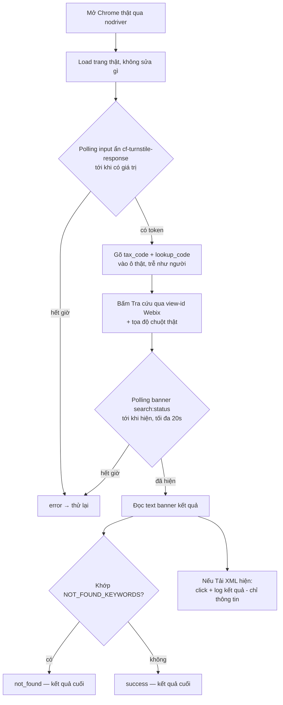

*[English](README.md) | Tiếng Việt*

# Nhánh ezsolver

Tích hợp [`ismoiloffS/EzSolver`](https://github.com/ismoiloffS/EzSolver)
(MIT) để test trang tra cứu `tracuu.einvoice365.com` của chúng ta. Xem
[nhánh `main`](../../tree/main) để có tổng quan và bảng so sánh với
`Turnstile-Solver`. Hướng dẫn cài/chạy: [`SETUP.md`](SETUP.md) /
[`SETUP.vi.md`](SETUP.vi.md).

## Hai bài test

| Script | Làm gì | Trả lời câu hỏi |
|---|---|---|
| `run_test.py` | Lấy token qua EzSolver, rồi gửi thẳng HTTP POST tới endpoint backend. | "Backend có chấp nhận token mà không cần phiên trình duyệt thật không?" |
| `run_ui_test.py` | Load trang thật, điền form thật, bấm nút "Tra cứu" thật, đọc kết quả. | "Site có phát hiện bot thao tác trên UI thật không?" |

Cả hai lặp qua 4 bộ `TEST_CASES` thật (tax_code / lookup_code) được chủ
sở hữu cho phép, trong `.env.example`.

## `run_ui_test.py` hoạt động thế nào

Điểm mấu chốt: `solve_on_page()` của EzSolver chạy
`document.body.innerHTML = ''` trước khi giải — nó **xóa sạch form
thật**. Nên `run_ui_test.py` không bao giờ gọi hàm đó; nó chỉ tái dùng
các hàm khởi chạy trình duyệt của EzSolver và tự lái trang thật.

## Giao diện dựng bằng Webix — vì sao click dùng tọa độ

- Chỉ 2 ô text là `<input>` thật → selector theo placeholder dùng được.
- Nút là `
` của Webix (không phải `<button>`), id DOM random mỗi
  lần tải lại. Mỗi view có **view-id ổn định** (`search:btnsearch`,
  `search:status`, `search:btnxml`) truy vấn qua `webix.$$(...)`. Ta tìm
  nút thật theo đó, rồi click bằng tọa độ + di chuột thật — recon thấy
  nút "Tải XML" cạnh bên **không có handler nào gắn**, nên `.click()`
  lập trình không đáng tin.
- Banner kết quả (`search:status`) có thể mất **5-8s** mới hiện — ta
  polling, không `sleep` cố định.
- `run_ui_test.py` cũng click "Tải XML" khi nó hiện và log xem có mở tab
  / tạo file blob không — chỉ mang tính thông tin, không ảnh hưởng kết
  quả. (Nút không có handler có vẻ là bug thật của site, nên báo riêng.)

## Kết quả & thử lại

Chỉ **lỗi kỹ thuật** mới retry (tối đa `MAX_ATTEMPTS`, mặc định 3) — câu
trả lời thật từ site luôn là kết quả cuối.

| Kết quả | Nghĩa là | Retry? |
|---|---|---|
| `success` | Banner hiện ra, không khớp cụm "không tìm thấy" | Không |
| `not_found` | Banner khớp `NOT_FOUND_KEYWORDS` (hợp lệ: "không có bản ghi") | Không |
| `error` | Một bước crash/timeout (kể cả không có banner trong thời gian chờ) | **Có** |

`run_test.py` có thêm kết quả thứ 4 là `rejected` (backend trả non-2xx),
cũng là kết quả cuối — đây chính là tín hiệu "backend có lớp thứ hai".

`NOT_FOUND_KEYWORDS` là danh sách **đoán, chưa xác nhận** — chỉnh lại khi
gặp phản hồi "không tìm thấy" thật.

## Logging

Mỗi lần chạy ghi `logs/<script>_<timestamp>.log` (chi tiết đầy đủ +
traceback) bên cạnh output console ngắn gọn. Khi một bước lỗi, còn lưu
thêm screenshot + HTML trang vào `logs/`. **`logs/` đã gitignore** — nó
có thể chứa dữ liệu hóa đơn thật.

## Yêu cầu

Chrome thật (không chỉ Chromium — `nodriver` điều khiển qua DevTools
Protocol); Xvfb trên Linux không GUI; `CHROME_PATH` nếu Chrome không tự
dò được. **Chưa chạy end-to-end ở đây** (sandbox này không có Chrome
thật / không có mạng tới mục tiêu) — xác nhận tên hàm nodriver với phiên
bản bạn cài ở lần chạy đầu trên máy.
