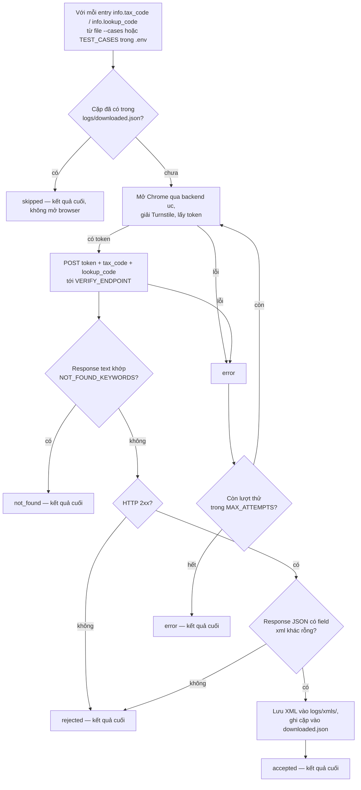
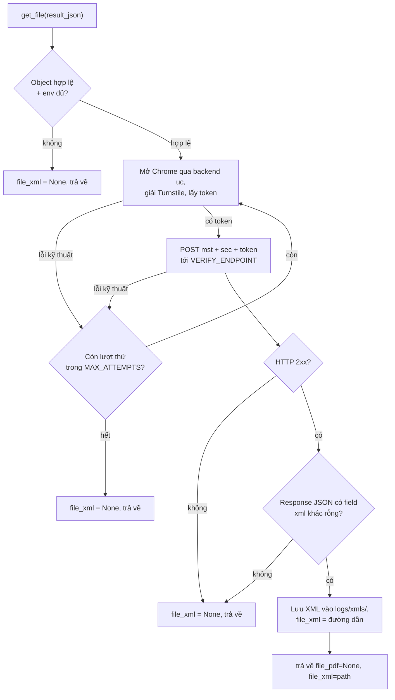

*[English](README.md) | Tiếng Việt*

# Nhánh ezsolver

Tích hợp [`ismoiloffS/EzSolver`](https://github.com/ismoiloffS/EzSolver)
(MIT) để test trang tra cứu `tracuu.einvoice365.com` của chúng ta. Xem
[nhánh `main`](../../tree/main) để có tổng quan. Hướng dẫn cài/chạy:
[`SETUP.md`](SETUP.md) / [`SETUP.vi.md`](SETUP.vi.md).

## Backend giải Turnstile

Chỉ `undetected-chromedriver` (`SOLVER_BACKEND=uc`,
`EzSolver/solver_uc.py`) vượt được Turnstile của site này — đây là
default cho 2 script bên dưới. `nodriver` và `playwright-stealth` đã
thử và bị chặn.

## Các script

| Script | Nhận vào | Làm gì |
|---|---|---|
| `get_tracuu_einvoice365.py` | **một** object result_json | Lấy **một** hóa đơn, trả về `{"file_pdf": None, "file_xml": <đường dẫn>}`. Đây là điểm vào để tích hợp — import `get_file()` vào project của bạn, hoặc chạy trực tiếp để lấy 1 file. |
| `run_test.py` | một **mảng** object | Harness test: giải Turnstile qua backend `uc`, gửi token tới `POST /api/search` (endpoint/payload reverse-engineer bằng `capture_request.py`) cho từng bộ, lưu từng XML. Hỗ trợ `MAX_WORKERS>1` để chạy song song, mỗi bộ 1 browser — trả lời: "Backend có nhận token mà không cần phiên trình duyệt thật, và có rate-limit không?" |
| `capture_request.py` | — | Chạy 1 lần: lái UI thật bằng `uc`, hook `fetch`/`XMLHttpRequest`, dump đúng request trang gửi vào `captured_request.json`. Dùng để tìm ra endpoint/payload. |

`run_test.py` lặp qua các cặp trong `test_cases.json` (hoặc `--cases <path>`);
`get_tracuu_einvoice365.py` xử lý đúng một cặp.

## Các lệnh chạy

```bash
cp .env.example .env            # cài 1 lần: set TARGET_SITEURL/SITEKEY
pip install -r requirements.txt
```

### Lấy MỘT hóa đơn (vào là 1 object → ra 1 file)

```bash
python get_tracuu_einvoice365.py --case '{"info": {"tax_code": "0314218920", "lookup_code": "j5nnm3lzo5"}}'
```

Hoặc đọc từ file chứa 1 object, hoặc pipe qua stdin:

```bash
python get_tracuu_einvoice365.py --file one_case.json
echo '{"info": {"tax_code": "...", "lookup_code": "..."}}' | python get_tracuu_einvoice365.py
```

In ra dict kết quả và lưu XML vào `logs/xmls/` (đổi bằng `--out <dir>`).
Đây là script để chạy khi chỉ tra 1 hồ sơ, và là module để import khi
tích hợp vào project của bạn (xem bên dưới).

### Bài test chính — bypass qua raw-HTTP chạy ngầm + tải XML (ưu tiên, không cần UI)

```bash
python run_test.py
```

Giải Turnstile, gửi thẳng token tới `POST /api/search`, và lưu file XML
hóa đơn thật vào `logs/xmls/` cho mỗi bộ test — đây là lệnh nên chạy mặc
định, không hỏi xác nhận. Bộ test lấy từ `test_cases.json` nếu file đó
tồn tại, không thì lấy từ `TEST_CASES` trong `.env` — dù nguồn nào cũng
phải là 1 mảng JSON các object dạng `{"info": {"tax_code": "...",
"lookup_code": "..."}}`; cặp nào đã có trong `logs/downloaded.json` sẽ bị
skip. Dùng file khác (ví dụ batch 1000 bộ) bằng:

```bash
python run_test.py --cases /đường/dẫn/tới/file_của_bạn.json
```

(thay `/đường/dẫn/tới/file_của_bạn.json` bằng đường dẫn thật tới file của bạn)

### Tương tự nhưng chạy N bộ cùng lúc (để dò xem có bị rate-limit không)

```bash
MAX_WORKERS=4 python run_test.py
```

Chạy đồng thời tối đa 4 bộ hồ sơ, mỗi bộ 1 browser riêng, để xem backend
có chặn/đánh dấu các request đồng thời giống nhau không.

### Chạy 1 lần: capture đúng request mà trang thật gửi

```bash
python capture_request.py
```

Đã chạy 1 lần để reverse-engineer endpoint/payload cho `run_test.py`;
chỉ chạy lại nếu frontend của site thay đổi.

## `run_test.py` hoạt động thế nào



Để lấy một hóa đơn, dùng `get_tracuu_einvoice365.py` — cùng luồng
giải+verify+lưu, vào 1 object ra 1 file (xem **Tích hợp**).

Các bộ test khác nhau chạy song song khi `MAX_WORKERS>1` (mỗi bộ 1 browser
riêng, qua `ThreadPoolExecutor`); chỉ `error` mới retry — `skipped`,
`not_found`, `rejected`, `accepted` luôn là kết quả cuối.

## Kết quả & thử lại

Chỉ **lỗi kỹ thuật** mới retry (tối đa `MAX_ATTEMPTS`) — câu trả lời
thật từ site luôn là kết quả cuối.

| Kết quả | Nghĩa là | Retry? |
|---|---|---|
| `accepted` | HTTP 2xx và đã lưu được file XML | Không |
| `rejected` | Backend trả non-2xx | Không |
| `not_found` | Response khớp `NOT_FOUND_KEYWORDS` (hợp lệ: "không có bản ghi") | Không |
| `error` | Lấy token hoặc gửi HTTP request thất bại | **Có** |
| `skipped` | XML đã được tải ở lần chạy trước | Không |

## Chạy song song nhiều bộ

`run_test.py` với `MAX_WORKERS>1` trong `.env` chạy đồng thời nhiều bộ
hồ sơ, mỗi bộ 1 browser riêng — dùng để kiểm tra backend có chặn/đánh
dấu các request đồng thời giống nhau từ 1 máy không (tại thời điểm test
này, chưa chặn).

`NOT_FOUND_KEYWORDS` là danh sách **đoán, chưa xác nhận** — chỉnh lại khi
gặp phản hồi "không tìm thấy" thật.

## Logging

Mỗi lần chạy ghi `logs/<script>_<timestamp>.log` (chi tiết đầy đủ +
traceback) bên cạnh output console ngắn gọn. Khi một bước lỗi, còn lưu
thêm screenshot + HTML trang vào `logs/`. File XML tải được qua
`run_test.py` nằm ở `logs/xmls/`. **`logs/` đã gitignore** — nó có thể
chứa dữ liệu hóa đơn thật.

## Tích hợp

Cách dùng đúng là thay thế `GetFolderTraCuuEinvoice365.get_file`: clone repo
này thành **một folder riêng** bên trong project chính, rồi gọi
`get_file(result_json)` với một object.

### Bố cục sau khi clone

```
project-cua-ban/
├── app.py                      # code của bạn
├── services/
│   └── invoice_service.py      # nơi gọi get_file
└── turnstile-bypass-test/      # REPO NÀY, clone thành 1 folder
    ├── get_tracuu_einvoice365.py
    ├── EzSolver/
    ├── requirements.txt
    └── .env                    # tạo từ .env.example
```

### Các bước

**1. Clone vào folder con**

```bash
cd project-cua-ban
git clone -b ezsolver-v2 https://github.com/Le-atuan/turnstile-bypass-test.git
```

Thêm `turnstile-bypass-test/` vào `.gitignore` của project cha, hoặc dùng
git submodule, để tránh lồng repo trong repo.

**2. Cài dependencies vào ĐÚNG môi trường Python của project**

```bash
pip install -r turnstile-bypass-test/requirements.txt
```

Cài vào cùng venv/interpreter mà app đang chạy. Máy phải có Google Chrome
thật (xem mục Yêu cầu).

**3. Tạo `.env` bên trong folder đã clone**

```bash
cp turnstile-bypass-test/.env.example turnstile-bypass-test/.env
```

Không cần sửa gì nếu target không đổi. File `.env` này **vẫn được tìm thấy**
kể cả khi app chạy từ thư mục cha — `python-dotenv` dò theo vị trí file
module, không theo thư mục làm việc hiện tại.

**4. Import và gọi**

Tên folder `turnstile-bypass-test` có dấu gạch ngang nên không import thẳng
được — phải thêm vào `sys.path` trước:

```python
# services/invoice_service.py
import os, sys

VENDOR = os.path.join(os.path.dirname(__file__), "..", "turnstile-bypass-test")
sys.path.insert(0, os.path.abspath(VENDOR))

from get_tracuu_einvoice365 import get_file

def lay_hoa_don(result_json):
    # result_json là object API bên bạn trả về
    result = get_file(result_json)             # tùy chọn: get_file(result_json, download_dir="/thư/mục/của/bạn")
    # -> {"file_pdf": None, "file_xml": "/abs/path/invoice_...xml" | None}
    return result
```

`EzSolver/` được thêm vào path tự động (theo vị trí file module), nên thư
mục làm việc không quan trọng.

### `get_file()` hoạt động thế nào



Khác `run_test.py`: không kiểm `downloaded.json` (luôn lấy mới), không
phân nhánh `not_found` riêng (không có XML thì trả `None`), và retry bao
trọn cả bước giải token lẫn gửi HTTP.

### Hợp đồng (contract)

- **Vào** — một dict `result_json` dạng `{"info": {"tax_code", "lookup_code"}}`
  (một object, không phải mảng). Mảng là việc của `run_test.py`. Nếu API
  của bạn trả cấu trúc khác, chỉnh lại hàm `extract_pair()`.
- **Ra** — `{"file_pdf": None, "file_xml": <đường dẫn tuyệt đối | None>}`.
  `file_pdf` luôn `None` (luồng này chỉ lấy XML).
- **Retry** — chỉ khi **lỗi kỹ thuật** (lấy token/HTTP hỏng), tối đa
  `MAX_ATTEMPTS`. Câu trả lời "không có file" rõ ràng là kết quả cuối.
- **Cấu hình** — đọc từ `.env`/môi trường: `TARGET_SITEURL`,
  `TARGET_SITEKEY`, `VERIFY_ENDPOINT`, `VERIFY_TOKEN_FIELD`,
  `SOLVER_BACKEND` (`uc`), `MAX_ATTEMPTS`, `DOWNLOAD_DIR`.

### Những điều dễ dính bẫy

- **Tên folder có dấu `-`** → dùng `sys.path.insert(...)` rồi
  `import get_tracuu_einvoice365`; không `import turnstile-bypass-test` được.
- **File XML tải xuống nằm trong folder đã clone**
  (`turnstile-bypass-test/logs/xmls/`) vì đường dẫn tính theo vị trí module.
  Đổi bằng `get_file(obj, download_dir="/chỗ/khác")` hoặc `DOWNLOAD_DIR` trong `.env`.
- **Cấu hình đọc lúc import.** Muốn set bằng `os.environ` thay vì `.env` thì
  phải set **trước khi** import module. Dùng `.env` thì không vướng.
- **Không side effect khi import** — module không thêm log handler và không
  mở browser lúc import; chỉ mở browser khi gọi `get_file()`. Cấu hình logger
  `get_tracuu_einvoice365` nếu muốn thấy log của nó.

## Yêu cầu

Chrome thật (không chỉ Chromium — `undetected-chromedriver` điều khiển);
Xvfb trên Linux không GUI; `CHROME_PATH` nếu Chrome không tự dò được.
