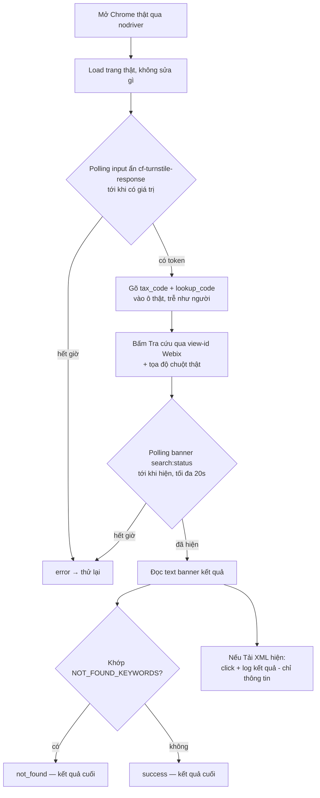

*[English](README.md) | Tiếng Việt*

# Nhánh ezsolver

Tích hợp [`ismoiloffS/EzSolver`](https://github.com/ismoiloffS/EzSolver)
(MIT) để test trang tra cứu `tracuu.einvoice365.com` của chúng ta. Xem
[nhánh `main`](../../tree/main) để có tổng quan. Hướng dẫn cài/chạy:
[`SETUP.md`](SETUP.md) / [`SETUP.vi.md`](SETUP.vi.md).

## Backend giải Turnstile

Chỉ `undetected-chromedriver` (`SOLVER_BACKEND=uc`,
`EzSolver/solver_uc.py`) vượt được Turnstile của site này — đây là
default cho 2 script bên dưới. `nodriver` và `playwright-stealth` đã
thử và bị chặn; `run_ui_test.py` (dùng nodriver) chỉ giữ làm bản tham
khảo gốc, không dùng để test thật nữa.

## Các bài test

| Script | Làm gì | Trả lời câu hỏi |
|---|---|---|
| `run_test.py` | Lấy token qua EzSolver (`uc`), rồi gửi thẳng HTTP POST tới `POST /api/search` (endpoint/payload reverse-engineer bằng `capture_request.py`). Chạy ngầm, bước gửi HTTP không cần trình duyệt hiện. Hỗ trợ `MAX_WORKERS>1` để chạy song song nhiều bộ hồ sơ, mỗi bộ 1 browser riêng. | "Backend có chấp nhận token mà không cần phiên trình duyệt thật, và có chặn request đồng thời không?" |
| `run_ui_test_uc.py` | Load trang thật, điền form thật, bấm "Tra cứu", bấm "Tải XML" và xác nhận có blob tải xuống thật. Log thời gian trung bình từ bước 1 → tải XML. | "Site có phát hiện bot thao tác trên UI thật, tới tận lúc tải được XML không?" |
| `run_ui_test.py` | Cùng luồng UI như trên nhưng dùng `nodriver` — giữ để tham khảo; bị Turnstile của site này chặn. | — |
| `capture_request.py` | Chạy 1 lần: lái UI thật bằng `uc`, hook `fetch`/`XMLHttpRequest`, dump đúng request trang gửi vào `captured_request.json`. Dùng để tìm ra endpoint/payload cho `run_test.py`. | — |

Tất cả lặp qua các bộ `TEST_CASES` (tax_code / lookup_code) trong `.env`.

## Các lệnh chạy

```bash
cp .env.example .env            # cài 1 lần: set TARGET_SITEURL/SITEKEY/TEST_CASES
pip install -r requirements.txt
```

### Bài test chính — bypass qua raw-HTTP chạy ngầm + tải XML (ưu tiên, không cần UI)

```bash
python run_test.py
```

Giải Turnstile, gửi thẳng token tới `POST /api/search`, và lưu file XML
hóa đơn thật vào `logs/xmls/` cho mỗi bộ test — đây là lệnh nên chạy mặc
định.

### Tương tự nhưng chạy N bộ cùng lúc (để dò xem có bị rate-limit không)

```bash
MAX_WORKERS=4 python run_test.py
```

Chạy đồng thời tối đa 4 bộ hồ sơ, mỗi bộ 1 browser riêng, để xem backend
có chặn/đánh dấu các request đồng thời giống nhau không.

### Luồng UI thật đầy đủ (điền form, bấm nút thật, xác nhận tải blob thật)

```bash
python run_ui_test_uc.py
```

Lái trang thật từ đầu tới cuối và log thời gian trung bình từ bước 1 →
tải XML — chỉ dùng khi cần test riêng luồng UI.

### Chạy 1 lần: capture đúng request mà trang thật gửi

```bash
python capture_request.py
```

Đã chạy 1 lần để reverse-engineer endpoint/payload cho `run_test.py`;
chỉ chạy lại nếu frontend của site thay đổi.

## `run_ui_test.py` hoạt động thế nào



Điểm mấu chốt: `solve_on_page()` của EzSolver chạy
`document.body.innerHTML = ''` trước khi giải — nó **xóa sạch form
thật**. Nên `run_ui_test.py` không bao giờ gọi hàm đó; nó chỉ tái dùng
các hàm khởi chạy trình duyệt của EzSolver và tự lái trang thật.

## Giao diện dựng bằng Webix — vì sao click dùng tọa độ

- Chỉ 2 ô text là `<input>` thật → selector theo placeholder dùng được.
- Nút là `<div>` của Webix (không phải `<button>`), id DOM random mỗi
  lần tải lại. Mỗi view có **view-id ổn định** (`search:btnsearch`,
  `search:status`, `search:btnxml`) truy vấn qua `webix.$$(...)`. Ta tìm
  nút thật theo đó, rồi click bằng tọa độ + di chuột thật — recon thấy
  nút "Tải XML" cạnh bên **không có handler nào gắn**, nên `.click()`
  lập trình không đáng tin.
- Banner kết quả (`search:status`) có thể mất **5-8s** mới hiện — ta
  polling, không `sleep` cố định.
- `run_ui_test.py` cũng click "Tải XML" khi nó hiện và log xem có mở tab
  / tạo file blob không — chỉ mang tính thông tin, không ảnh hưởng kết
  quả. (Nút không có handler có vẻ là bug thật của site, nên báo riêng.)

## Kết quả & thử lại

Chỉ **lỗi kỹ thuật** mới retry (tối đa `MAX_ATTEMPTS`) — câu trả lời
thật từ site luôn là kết quả cuối. **`success` chỉ tính khi tải được
file XML xuống thật (xác nhận qua blob mới) hoặc site báo "không tìm
thấy"** — mọi trường hợp khác (ví dụ nút "Tải XML" xuất hiện nhưng
không tạo blob) tính là `error`, không phải success.

| Kết quả | Nghĩa là | Retry? |
|---|---|---|
| `success` | Xác nhận tải được XML (`run_ui_test_uc.py`) / banner hiện và không khớp "không tìm thấy" (`run_test.py`) | Không |
| `not_found` | Banner/response khớp `NOT_FOUND_KEYWORDS` (hợp lệ: "không có bản ghi") | Không |
| `error` | Một bước crash/timeout, kể cả khi "Tải XML" xuất hiện nhưng không xác nhận được tải xuống | **Có** |

`run_test.py` có thêm kết quả thứ 4 là `rejected` (backend trả non-2xx),
cũng là kết quả cuối — đây chính là tín hiệu "backend có lớp thứ hai".

Dòng SUMMARY của `run_ui_test_uc.py` còn báo **thời gian trung bình từ
bước 1 → tải XML**, chỉ tính trên các lần xác nhận tải được.

## Chạy song song nhiều bộ

`run_test.py` với `MAX_WORKERS>1` trong `.env` chạy đồng thời nhiều bộ
hồ sơ, mỗi bộ 1 browser riêng — dùng để kiểm tra backend có chặn/đánh
dấu các request đồng thời giống nhau từ 1 máy không (tại thời điểm test
này, chưa chặn).

`NOT_FOUND_KEYWORDS` là danh sách **đoán, chưa xác nhận** — chỉnh lại khi
gặp phản hồi "không tìm thấy" thật.

## Logging

Mỗi lần chạy ghi `logs/<script>_<timestamp>.log` (chi tiết đầy đủ +
traceback) bên cạnh output console ngắn gọn. Khi một bước lỗi, còn lưu
thêm screenshot + HTML trang vào `logs/`. File XML tải được qua
`run_test.py` nằm ở `logs/xmls/`. **`logs/` đã gitignore** — nó có thể
chứa dữ liệu hóa đơn thật.

### Script dọn dẹp

```bash
./clear_logs.sh       # xóa tất cả file *.log trong logs/
./clear_images.sh     # xóa tất cả screenshot/HTML lỗi (*.png, *.html) trong logs/
./clear_xmls.sh       # xóa tất cả file XML đã tải trong logs/xmls/
./clear_run_test.sh   # xóa tất cả log của run_test.py (logs/run_test_*.log)
./clear_ui_test.sh    # xóa tất cả log của run_ui_test.py / run_ui_test_uc.py (logs/ui_test_*.log)
```

## Yêu cầu

Chrome thật (không chỉ Chromium — `nodriver` điều khiển qua DevTools
Protocol); Xvfb trên Linux không GUI; `CHROME_PATH` nếu Chrome không tự
dò được. **Chưa chạy end-to-end ở đây** (sandbox này không có Chrome
thật / không có mạng tới mục tiêu) — xác nhận tên hàm nodriver với phiên
bản bạn cài ở lần chạy đầu trên máy.
